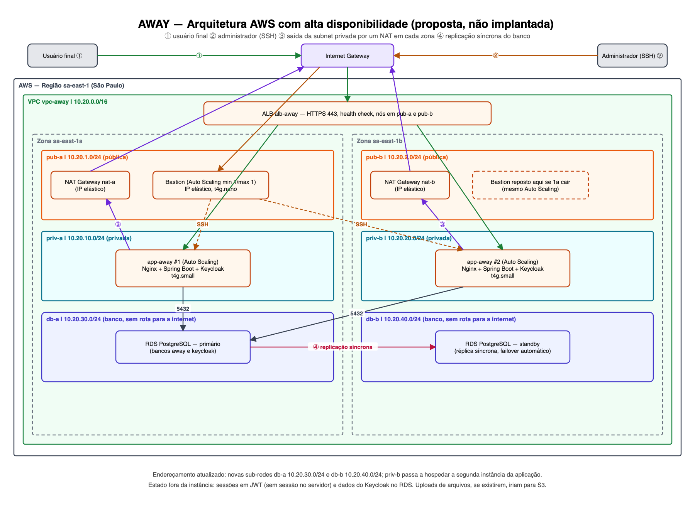

# Alta disponibilidade (Parte C) — proposta, não implantada

> A alta disponibilidade é **apenas projetada**. Nada desta proposta é criado pelo código em `infra/`. Os diagramas estão em [`diagramas/arquitetura-ha.png`](diagramas/arquitetura-ha.png) (fonte editável: [`arquitetura-ha.drawio`](diagramas/arquitetura-ha.drawio)). A versão da Entrega 1 continua em [`diagramas/arquitetura.png`](diagramas/arquitetura.png) para comparação.

## H1. Duas ou mais zonas de disponibilidade e endereçamento atualizado

Os recursos passam a ser distribuídos entre `sa-east-1a` e `sa-east-1b`. As quatro sub-redes da Entrega 1 são mantidas, e **duas sub-redes novas** isolam o banco.

| Sub-rede | CIDR | Zona | Tipo | Conteúdo na proposta | Situação |
|---|---|---|---|---|---|
| `pub-a` | `10.20.1.0/24` | 1a | Pública | NAT, bastion, nó do ALB | Já existe |
| `pub-b` | `10.20.2.0/24` | 1b | Pública | **NAT**, nó do ALB, bastion reposto | Já existe |
| `priv-a` | `10.20.10.0/24` | 1a | Privada | **Instância de aplicação #1** | Já existe |
| `priv-b` | `10.20.20.0/24` | 1b | Privada | **Instância de aplicação #2** (hoje vazia) | Já existe |
| `db-a` | `10.20.30.0/24` | 1a | Privada, sem rota para a internet | **RDS primário** | **Nova** |
| `db-b` | `10.20.40.0/24` | 1b | Privada, sem rota para a internet | **RDS standby** | **Nova** |

A VPC `10.20.0.0/16` não precisa ser alterada: os novos `/24` cabem no bloco existente, sem renumerar nada (ver Entrega 1, seção 5.3).

## H2. Balanceador e instâncias da aplicação

- O **ALB** já cobre as duas zonas (pub-a e pub-b). Passa a distribuir o tráfego entre **duas instâncias** `app-away`, uma em cada zona.
- As instâncias ficam em um **grupo de Auto Scaling** (mínimo 2, desejado 2, máximo 3), com *launch template* que reaplica o *cloud-init* de SSH endurecido e a instalação da aplicação pelo Ansible (ou uma imagem AMI pré-pronta).
- **Health check:** o *target group* testa `GET /` no Nginx a cada 30 s (2 sucessos = saudável, 3 falhas = fora). O Auto Scaling usa o health check do ALB (`health_check_type = "ELB"`), então uma instância doente é **substituída**, não só retirada da rotação.

## H3. Estratégia de NAT: um por zona

**Decisão:** um NAT Gateway **em cada zona** (`nat-a` em `pub-a`, `nat-b` em `pub-b`). A tabela de rotas privada de cada zona aponta para o NAT da própria zona.

- **Consequência:** se a zona 1a cair, as instâncias da zona 1b continuam com saída para a internet. Com um NAT compartilhado em 1a, a queda dessa zona **cortaria a saída das duas** (e o tráfego entre zonas ainda seria cobrado).
- **Custo:** o NAT é o item mais caro (US$ 68,82 por mês). Um segundo NAT **soma esse valor**.
- **Observação:** a saída para a internet é usada só para atualizações de pacotes e imagens. Os usuários continuam sendo atendidos pelo ALB mesmo sem NAT. Isso é o que torna a alternativa "NAT compartilhado" aceitável, e ela é avaliada em `custos/ha.md`.

## H4. Estratégia para o banco

**Decisão:** **Amazon RDS Multi-AZ**. A AWS mantém uma **réplica síncrona** (standby) em `sa-east-1b` e faz o *failover* automático, normalmente em 1 a 2 minutos, mantendo o **mesmo endereço (endpoint)**. A aplicação só precisa reconectar, e o pool de conexões do Spring faz isso.

- Alternativas descartadas: uma réplica de leitura (não faz *failover* automático) e PostgreSQL próprio em EC2 com replicação manual (o grupo passaria a operar o banco, contrariando o ADR-003).
- O **Keycloak também passa a usar o RDS**, em um banco separado (`keycloak`), em vez do H2 local. Isso é necessário para H5.
- **O Multi-AZ não substitui o backup:** a réplica também recebe um `DELETE` errado. Ver [`backup.md`](backup.md).

## H5. Estado da aplicação fora da instância

Para que **qualquer** instância atenda **qualquer** requisição:

| Estado | Onde fica hoje | Onde fica na proposta |
|---|---|---|
| **Sessão do usuário** | Não há sessão no servidor: a autenticação é por **token JWT** emitido pelo Keycloak, guardado no navegador e validado pelo backend a cada requisição | Igual. O backend é *stateless* |
| **Dados do sistema** | RDS | RDS Multi-AZ |
| **Usuários, perfis e chaves do Keycloak** | Banco **H2 em volume local** da instância (se a instância morre, somem os usuários criados) | **RDS**, banco `keycloak`, compartilhado pelas duas instâncias (as chaves de assinatura dos tokens passam a ser as mesmas nas duas) |
| **Arquivos enviados** | Não existem: o backend não implementa *upload* | Se forem criados no futuro, devem ir para **S3**, e nunca para o disco da instância |
| **Cache de sessão do Keycloak** | Memória do container | Por nó. O backend usa só o token de acesso (sem *refresh token*), então não há impacto. Se o *refresh* for adotado, será necessário o cache distribuído do Keycloak (descoberta via JDBC) |

## H6. Pontos únicos de falha (seção 5.10 da Entrega 1)

| # | Ponto único de falha | Tratamento | Justificativa |
|---|---|---|---|
| 1 | Toda a computação e os dados em uma única zona (`sa-east-1a`) | **Eliminado** para zona: aplicação e banco passam a ter componentes nas duas zonas, e há um NAT por zona | Ver H1 a H4. **A região** continua sendo ponto único: aceito, pois o backup recomendado vai para outra região |
| 2 | Instância de aplicação única, sem redundância | **Eliminado**: Auto Scaling com mínimo de 2, uma por zona | Ver H2 |
| 3 | RDS Single-AZ sem réplica | **Eliminado** para falha de instância ou de zona: standby síncrono com *failover* automático | Ver H4. Não protege de erro lógico: isso é papel do backup |
| 4 | Bastion como único caminho de acesso administrativo | **Reduzido e aceito**: o bastion vira um Auto Scaling de **1 instância** que pode ser recriado na outra zona (IP elástico reassociado por script), em vez de duas instâncias | Um segundo bastion ligado o tempo todo custa dinheiro por um acesso que só é usado em manutenção. Aceita-se alguns minutos sem acesso SSH em caso de falha, enquanto o sistema segue atendendo os usuários |

Novos pontos únicos que a proposta passa a ter, e que ficam **aceitos**: o próprio ALB e o NAT são serviços gerenciados da AWS (redundantes por zona); a **região** inteira; o **DNS** do domínio na Hostinger; e o repositório Git como fonte do Terraform.

## H7. Fluxos numerados redesenhados

| Fluxo | Caminho na arquitetura atual (Entrega 1) | Caminho na proposta de HA |
|---|---|---|
| **① Usuário final** | Internet → IGW → ALB → instância única de aplicação | Internet → IGW → ALB (nós nas duas zonas) → **uma das duas instâncias** saudáveis |
| **② Administração** | Administrador → IGW → bastion (22) → aplicação (22) | Administrador → IGW → **bastion do Auto Scaling (IP elástico)** → qualquer das duas instâncias (22, só a partir do bastion) |
| **③ Saída para a internet** | Instância privada → NAT (em `pub-a`) → IGW | Cada instância privada → **NAT da própria zona** → IGW |
| **④ Replicação do banco (novo)** | Não existe | RDS primário (1a) → standby (1b), **síncrona**; as duas instâncias de aplicação falam sempre com o endpoint do primário |

## Custo da alta disponibilidade

A análise de custo (comparação com o cenário A da Entrega 1, itens que mais contribuem e a resposta sobre se o custo se justifica) está em [`custos/ha.md`](custos/ha.md).
